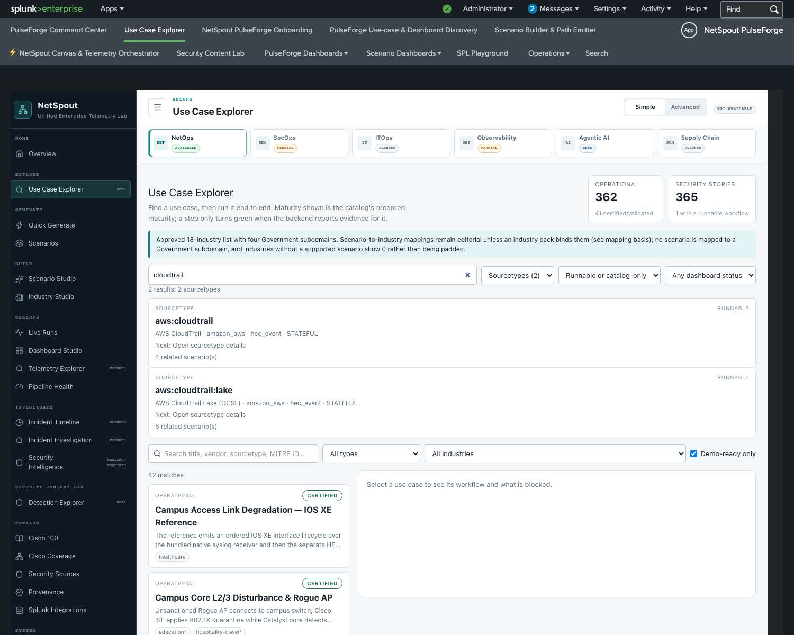
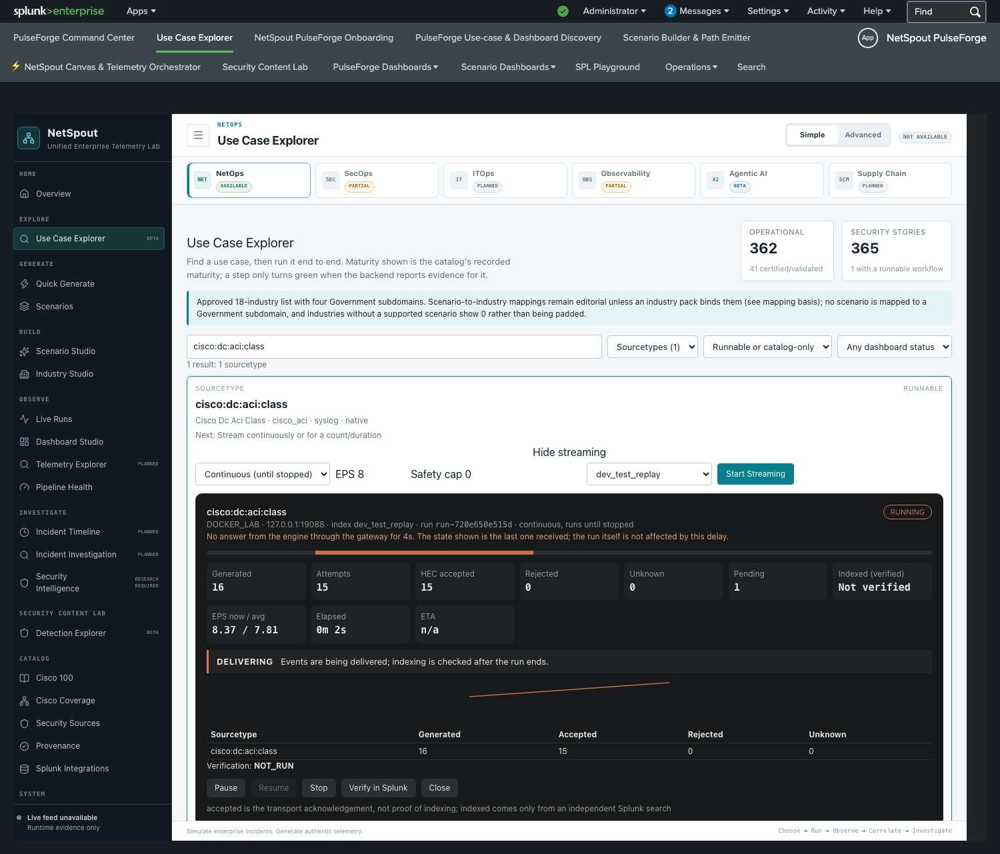
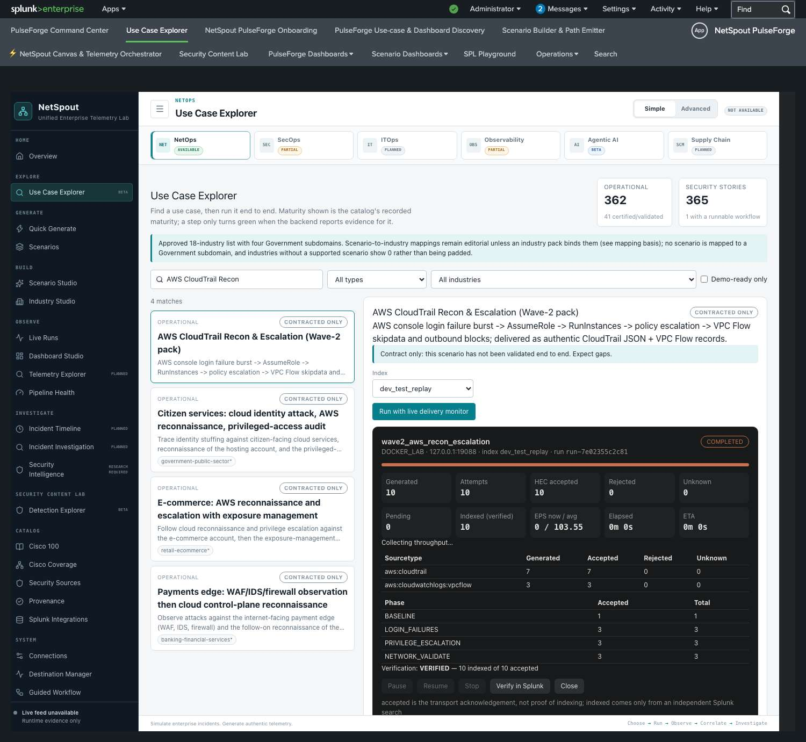
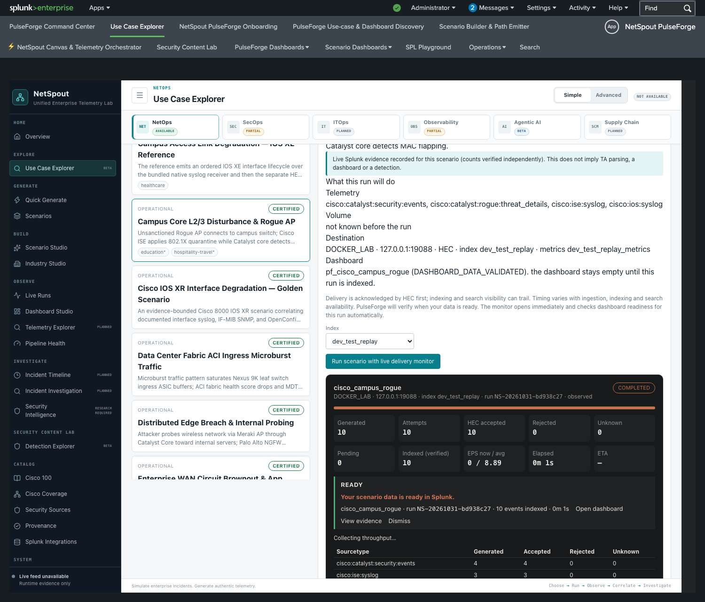
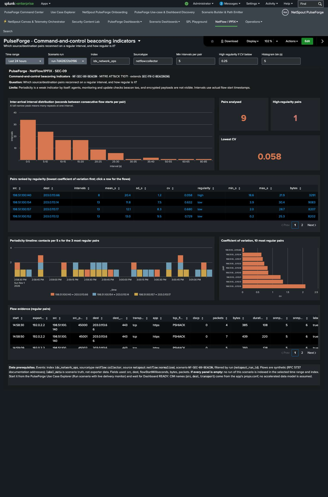
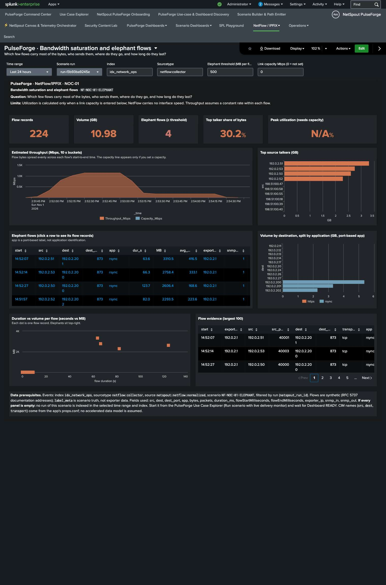

<div align="center">

<h1 align="center">NetSpout PulseForge</h1>

**Synthetic telemetry for Splunk: generate, replay, stream, verify, investigate.**

PulseForge generates and replays telemetry, runs correlated scenarios, proves what Splunk actually indexed, and opens a dashboard bound to that run.

[](LICENSE)
[](docs/guides/03_INSTALLATION.md)
[](netspout/default/app.conf)
[](docs/guides/README.md)

[Quick start](#quick-start) · [Capabilities](#what-you-can-do) · [Screenshots](#screenshots) · [Coverage](#coverage-at-a-glance) · [Configuration](#configuration) · [Documentation](#documentation)

</div>

---

## 30-second overview

PulseForge has **two parts**: a **Splunk app** (`netspout.spl`: UI, 148 Dashboard Studio dashboards, a gateway) and an **engine** (a Python service that generates the telemetry and talks to your Splunk HEC). You choose a sourcetype or a scenario, press run, watch delivery live, and PulseForge tells you when the data is **independently confirmed in Splunk** and the matching dashboard is ready.

```text
Search → Select → Preview → Configure → Generate / Stream → Live Monitor → Verify in Splunk → Dashboard READY → Open dashboard
```

> **Accepted is not indexed.** HEC acknowledgement and indexing are counted separately. "Indexed" only ever comes from an independent Splunk search keyed by the run id.

## Quick start

You use PulseForge through **Splunk Web** with your Splunk login. The engine is an internal component; you never open its port. Two ways to install:

### 1. Install with Docker (evaluation, bundled Splunk Enterprise)
```bash
cp .env.example .env        # set SPLUNK_PASSWORD and SPLUNK_HEC_TOKEN to your own values
docker compose up -d --build
```
Open <http://localhost:8000>, sign in with the Splunk credentials you set, and launch **NetSpout PulseForge** from the Apps menu. This starts Splunk Enterprise 10.2 with the app and the engine in one container.
**Status:** validated in an isolated lab in earlier phases; **not re-run for this revision**. Known gaps (hardening planned, see the [architecture decision](docs/architecture/PULSEFORGE_INSTALL_ARCHITECTURE_DECISION.md)): the engine port is still published on loopback, and the collector and OTel services are not yet optional. For an existing Splunk, use the engine-only deployment in the [installation guide](docs/guides/03_INSTALLATION.md#c-the-engine-customer-hosted-no-repository-checkout-needed).

### 2. Install into Splunk (existing Splunk Enterprise)
Install `netspout.spl` (Apps > Manage Apps > Install app from file), restart Splunk, and open the app.
**Status: not yet a single package.** Today the app also needs the PulseForge engine as a separate, customer-run service (engine-only Docker image or `pulseforge-engine.tar.gz`). A single-package Enterprise install is **feasible but not built**: a feasibility probe ran the real engine inside Splunk's own Python with vendored packages, and a phased plan with acceptance tests is in the [architecture decision](docs/architecture/PULSEFORGE_INSTALL_ARCHITECTURE_DECISION.md). Do not expect it from this release.

**Splunk Cloud:** `netspout_cloud.spl` is **dashboards only** (no generation). A full single-package Cloud app is not feasible (Cloud prohibits the UDP and listener functionality). The honest Cloud offering is dashboards plus a customer-hosted engine; Splunk Cloud validation has not been done and this is not an approval claim.

After installing, open **Use Case Explorer**, finish **Connection Center** (HEC URL, search URL, event and metrics indexes you have authorized; PulseForge never creates indexes), then search `cloudtrail` or `5G core user-plane degradation`, press **Run**, wait for **READY**, and open the dashboard. Tutorials: [User guide](docs/guides/05_USER_GUIDE.md). Building from source and running the engine by hand are developer tasks: [developer and advanced installation](docs/guides/03_INSTALLATION.md#developer-and-advanced-installation).

| Deployment | What it is | Status |
|---|---|---|
| Docker, bundled Splunk | `docker compose up -d --build` | validated lab option, not re-run for this revision |
| Splunk Enterprise app + engine | `netspout.spl` + engine you run | validated in an isolated lab; single package is a plan, not a feature |
| Engine only (existing Splunk or Cloud edition) | `deploy/docker/docker-compose.engine.yml` or `pulseforge-engine.tar.gz` | engine Docker image verified 2026-11-02; no Splunk attached in that test |
| Splunk Cloud dashboards | `netspout_cloud.spl`: **dashboards only**, no engine, no generation | built; **Splunk Cloud validation is not done**; not an approval claim |

## What you can do

| Capability | Status |
|---|---|
| **Universal search** across sourcetypes, scenarios and dashboards, with kind / runnable / vendor / protocol filters | supported |
| **Generate one sourcetype**, finite or **continuously until stopped**, at a configurable event rate | supported for 259 of 349 sourcetypes |
| **Native generation vs recorded-sample replay** per sourcetype, labelled honestly | supported |
| **Run a correlated scenario** with preview, configuration and a **Live Delivery Monitor** (pause, resume, stop where the engine supports it) | supported for 148 scenarios |
| **HEC connection test** and **independent indexing verification** | supported |
| **Dashboard readiness** (`GENERATING` … `READY` / `DEGRADED`) with a notification and a run-bound **Dashboard Studio** dashboard | supported |
| **NetFlow v9 / IPFIX** over UDP to a GoFlow2 collector, plus ten flow-pattern scenarios ([guide](docs/guides/12_NETFLOW_IPFIX_SOLUTION.md)) | supported |
| Native SNMPv2c and gNMI/OpenConfig | supported ([network telemetry guide](docs/guides/06_NETWORK_TELEMETRY_GUIDE.md)) |
| Standalone engine package, index allowlist, secrets only in the environment | supported |
| SNMPv3, sFlow, gRPC dial-out MDT, J-Flow-specific export, IPv6 flow | **not implemented** |
| CIM validation of sourcetypes, security detection verification | **not done** (0 sourcetypes CIM-validated, 0 detections verified) |
| Splunk Cloud HEC | **metrics only, bounded:** 5 synthetic metrics and one incident pack's gauges (30 datapoints) were accepted into a remote `test_metrics` index and independently found with `mstats`/`mcatalog` (Nov 2). Event-index delivery, the engine run path against Cloud, a rendered dashboard and vendor samples were **not** tested; see [telemetry guide](docs/guides/06_NETWORK_TELEMETRY_GUIDE.md#remote-test_metrics-status) |

Not every cataloged sourcetype or scenario is executable. Catalog-only entries are labelled and never offered a Run button.

## Screenshots

Captured from the installed app in the validation lab. Click to enlarge.

<table>
<tr>
<td align="center"><a href="docs/verification/evidence/search/screens/search_sourcetype.jpg"></a><br><sub>Universal search</sub></td>
<td align="center"><a href="docs/verification/evidence/search/screens/stream_running.jpg"></a><br><sub>Continuous streaming</sub></td>
<td align="center"><a href="docs/verification/evidence/monitor/screens/native_pack_final.jpg"></a><br><sub>Live Delivery Monitor</sub></td>
</tr>
<tr>
<td align="center"><a href="docs/verification/evidence/search/screens/readiness_ready.jpg"></a><br><sub>Dashboard readiness</sub></td>
<td align="center"><a href="docs/verification/evidence/netflow/screens/NF-SEC-09-BEACON.jpg"></a><br><sub>NetFlow beaconing indicators</sub></td>
<td align="center"><a href="docs/verification/evidence/netflow/screens/NF-NOC-01-ELEPHANT.jpg"></a><br><sub>NetFlow elephant flows</sub></td>
</tr>
</table>

## Coverage at a glance

Generated from the registries (`docs/reference/`), kept separate on purpose:

| Measure | Count |
|---|---|
| Canonical sourcetypes | 349 |
| Native generator coverage (sourcetypes) | 159 |
| Recorded-sample replay catalog (sourcetypes) | 143 |
| Streamable one at a time (77 native path + 182 recorded-sample) | 259 |
| Independently indexed sourcetypes (read back from Splunk) | 137 |
| Deduplicated scenario definitions | 372 |
| Runnable scenarios | 148 |
| Catalog-only scenarios | 209 |
| Installed dashboards | 148 |
| Dashboards data-validated or better | 148 |
| Dashboards visually verified (screenshot inspected) | 20 |

The Explorer's 700+ search entries include 365 security stories and are not the scenario count. Full references: [sourcetypes](docs/reference/SOURCETYPE_REFERENCE.md), [scenarios](docs/reference/SCENARIO_REFERENCE.md), [status and limitations](docs/guides/10_LIMITATIONS_AND_STATUS.md).

## Tech stack

| Layer | Technology (from the source) |
|---|---|
| Splunk app UI | React 19, TypeScript, Vite, Tailwind CSS (bundle in `netspout/appserver/static/dist`) |
| Engine | Python, FastAPI, Uvicorn, Pydantic, `src/netspout_core` |
| Dashboards | Splunk Dashboard Studio (v2), generated by `scripts/build_*dashboards.py` |
| Delivery | Splunk HTTP Event Collector, independent verification by Splunk REST search |
| Native protocols | SNMPv2c, gNMI/OpenConfig (gRPC, protobuf), NetFlow v9 and IPFIX over UDP |
| Flow collection | GoFlow2 v2.2.5 + a repo forwarder (`deploy/collector`) |
| Packaging | `netspout.spl`, `netspout_cloud.spl`, `pulseforge-engine.tar.gz` |
| Tests | pytest (backend/core), Playwright (browser checks) |

## Configuration

Complete list: [Installation guide](docs/guides/03_INSTALLATION.md), [Monitor and HEC test guide](docs/guides/11_LIVE_DELIVERY_MONITOR_AND_HEC_TEST.md). Secrets are read **only** from the environment.

| Setting | Purpose | Required | Default | Example |
|---|---|---|---|---|
| HEC URL, search URL, authorized indexes | Connection Center (UI or `POST /api/setup`) | yes | none | `https://splunk.example.com:8088/services/collector` |
| `NETSPOUT_HEC_TOKEN` | HEC token | yes | none | `<your-hec-token>` |
| `NETSPOUT_SPLUNK_PASSWORD` or `NETSPOUT_SPLUNK_TOKEN` | Search credentials for independent verification | for verification | none | `<your-splunk-password>` |
| `PULSEFORGE_ENGINE_HOST` / `PULSEFORGE_ENGINE_PORT` | Engine bind address (launcher) | no | `127.0.0.1:8081` | `127.0.0.1:8091` |
| `PULSEFORGE_STATE_DIR` / `NETSPOUT_CONFIG_DIR` | Connection Center config and run state (no secrets) | no | `~/.pulseforge` | `/var/lib/pulseforge` |
| `NETSPOUT_BACKEND_URL` | Where the Splunk gateway finds the engine | if not default | `http://127.0.0.1:8081` | `http://host.docker.internal:8091` |
| `NETSPOUT_COLLECTOR_HOST`, `NETSPOUT_GOFLOW_METRICS_URL`, `NETSPOUT_FLOW_FORWARDER_STATUS_URL` | Native flow collector | flow only | loopback | `http://127.0.0.1:8080/metrics` |
| TLS verification | On by default; `allow_insecure_tls` is accepted only for loopback lab endpoints | n/a | verify | |

<details>
<summary>Advanced configuration: collectors, TLS, HEC and indexing troubleshooting</summary>

* **Collectors.** NetFlow/IPFIX needs the GoFlow2 collector and forwarder from `deploy/collector` (needs `SPLUNK_HEC_TOKEN`, `SPLUNK_HEC_URL`, `SPLUNK_INDEX`). See [native flow quickstart](docs/guides/NATIVE_FLOW_QUICKSTART.md) and the [NetFlow guide](docs/guides/12_NETFLOW_IPFIX_SOLUTION.md). Without a collector the flow wire stage reports `COLLECTOR_UNREACHABLE`; HEC delivery still works.
* **TLS.** Certificate errors are reported as `TLS_CERTIFICATE`. Fix the certificate; do not disable verification outside a loopback lab.
* **HEC.** A token without access to the index produces a rejection; an unknown index can be accepted and never found, which is why indexing is a separate status. Run the HEC connection test first.
* **Indexing delay.** Search visibility can trail HEC acceptance. Readiness re-checks for 180 s after delivery ends before reporting `DEGRADED`; no ETA is invented.
* **After reinstalling the app, restart splunkd.** Splunk caches the static UI bundle and serves the old one until then.
* More: [Troubleshooting](docs/guides/09_TROUBLESHOOTING.md), [security](docs/SECURITY.md).

</details>

<details>
<summary>Known limitations</summary>

* The 90 sourcetypes that cannot be grounded in a native generator or recorded sample are catalog-only.
* 209 scenario definitions are catalog-only; 15 more are contracts without executable telemetry.
* Validated in an isolated Docker lab. `netspout_cloud.spl` (dashboards only) passed AppInspect cloud rules; that is **not** Splunk Cloud approval.
* Native flow export over UDP is unreliable by nature. The repository's collector compose file runs GoFlow2 with `workers=1` (several workers dropped records for lack of a template; fixed and measured at 100% decoded in the lab). The run panel always shows exported versus collector-decoded counts rather than hiding a gap.
* Telemetry for incident packs is modeled by NetSpout, not vendor-native. Details: [Limitations and status](docs/guides/10_LIMITATIONS_AND_STATUS.md), [LIMITATIONS](docs/LIMITATIONS.md).

</details>

## Documentation

Organized by purpose (Diátaxis). The guides below are the documentation; nothing is duplicated here.

| Learn (tutorials) | Do (how-to) |
|---|---|
| [Installation: first working setup](docs/guides/03_INSTALLATION.md) | [Configure a destination and test HEC](docs/guides/11_LIVE_DELIVERY_MONITOR_AND_HEC_TEST.md) |
| [User guide: first stream, first scenario, first dashboard](docs/guides/05_USER_GUIDE.md) | [Stream, pause, resume, stop; verify indexed data](docs/guides/11_LIVE_DELIVERY_MONITOR_AND_HEC_TEST.md) |
| [Quickstart](docs/QUICKSTART.md) | [Run a NetFlow/IPFIX scenario](docs/guides/12_NETFLOW_IPFIX_SOLUTION.md) |
| | [Configure native flow collectors](docs/guides/NATIVE_FLOW_QUICKSTART.md) |
| | [Troubleshoot ingestion](docs/guides/09_TROUBLESHOOTING.md) |
| | [Run the Nov 3 demo](docs/guides/13_DEMO_RUNBOOK.md) |

| Reference | Explanation |
|---|---|
| [Sourcetype reference](docs/reference/SOURCETYPE_REFERENCE.md) | [Product overview](docs/guides/01_PRODUCT_OVERVIEW.md) |
| [Scenario reference](docs/reference/SCENARIO_REFERENCE.md) | [Architecture and deployment](docs/guides/02_ARCHITECTURE_AND_DEPLOYMENT.md) |
| [Dashboard guide and inventory](docs/guides/07_DASHBOARD_GUIDE.md) | [Native vs sample replay, HEC acceptance vs indexing](docs/guides/11_LIVE_DELIVERY_MONITOR_AND_HEC_TEST.md) |
| [Network protocol guide](docs/guides/06_NETWORK_TELEMETRY_GUIDE.md) | [Security, TA and CIM status](docs/guides/08_SECURITY_TA_CIM_GUIDE.md) |
| [Limitations and status](docs/guides/10_LIMITATIONS_AND_STATUS.md) | [Security and index allowlist](docs/SECURITY.md) |
| [Splunk Cloud guide](docs/guides/04_SPLUNK_CLOUD_GUIDE.md) | [Telemetry provenance](docs/TELEMETRY_PROVENANCE.md) |
| [Verification evidence](docs/verification/) · [Release acceptance](docs/verification/release_acceptance_final.md) · [NetFlow verification](docs/verification/netflow_solution_verification.md) · [Release notes](docs/releases/NETSPOUT_V1_RC1_RELEASE_REPORT.md) | [Roadmap](docs/ROADMAP.md) |

## Safety

Native simulated servers bind to loopback by default. gNMI `SetRequest` is disabled and SNMP `SetRequest` is rejected. No credentials are committed; tokens and passwords come from the environment. Synthetic flows use RFC 5737 documentation addresses.

## License

[Apache-2.0](LICENSE). Third-party notices: [THIRD_PARTY_NOTICES.md](THIRD_PARTY_NOTICES.md). Maintainer: [machowdhury](https://github.com/machowdhury).
