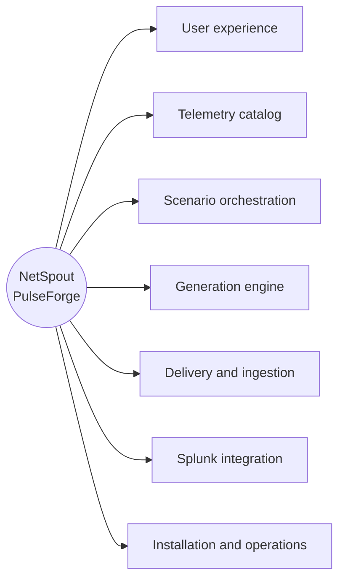

# NetSpout PulseForge: application mind map

Three diagrams, each with an editable Mermaid source in `diagrams/` and renders next to this file.

| Diagram | Source | PNG | SVG |
|---|---|---|---|
| Technical map (all seven branches, detail) | `diagrams/mindmap_technical.mmd` | `NetSpout_Application_Mindmap.png` | `NetSpout_Application_Mindmap.svg` |
| Executive map (one line per branch) | `diagrams/mindmap_executive.mmd` | `NetSpout_Application_Mindmap_Executive.png` | `NetSpout_Application_Mindmap_Executive.svg` |
| End-to-end workflow | `diagrams/workflow.mmd` | `NetSpout_End_to_End_Workflow.png` | `NetSpout_End_to_End_Workflow.svg` |

To re-render after editing a source: paste it into <https://mermaid.live> and export, or render with any Mermaid 11 toolchain. The PNGs here were rendered with Mermaid 11.4.1 in headless Chromium at 3x scale.

## Technical map

The full detail (the cards on the right of each branch) is in `diagrams/mindmap_technical.mmd`; the table below lists the same content with the repository evidence for each statement.

## Branch to repository evidence

| Branch | Statement on the map | Where it is verified |
|---|---|---|
| User experience | Splunk Web app with a React UI in an iframe; Simple and Advanced modes; Command Center, Use Case Explorer, Quick Generate, Scenarios, Scenario Studio, Industry Studio, Live Runs, Dashboard Studio, Pipeline Health, Cisco 100, Cisco Coverage, Security Sources, Provenance, Connections, Destination Manager | `frontend/src/components/shell/AppShell.tsx`; `netspout/default/data/ui/nav/default.xml`; screenshots of the live app (Command Center, Explorer) |
| User experience | Perspectives: NetOps available, SecOps and Observability partial, others planned | Command Center screenshot (status badges are the app's own) |
| Telemetry catalog | 349 sourcetypes, 88 vendors | demo engine `GET /api/catalog/sourcetypes` and `/api/catalog/vendors`, checked 2026-11-02 |
| Telemetry catalog | Generator tiers: 159 native engine, 143 sample replay, 47 none | `docs/reference/sourcetype_coverage.json` |
| Telemetry catalog | 33 replay packs | demo engine `GET /api/replay/packs`, checked 2026-11-02 |
| Telemetry catalog | Provenance labels (native contract, Splunk contract, NetSpout schema) | Command Center "Telemetry trust" panel; `docs/TELEMETRY_PROVENANCE.md` |
| Scenario orchestration | 372 defined, 372 runnable on main; 148 in the released app | `docs/SCENARIOS.md`; `docs/guides/13_DEMO_RUNBOOK.md` |
| Scenario orchestration | NetFlow solution, 10 NF scenarios | `backend/app/netflow_solution.py`; `docs/verification/evidence/netflow/` |
| Scenario orchestration | 224 declarative contracts; fidelity 10 vendor-native, 30 mixed, 184 modeled | `catalog/scenario_contracts.json`; `src/netspout_core/scenario_contracts.py`; `docs/reference/SCENARIO_FIDELITY_AUDIT.md` |
| Generation engine | SplunkLogEngine formatters | `backend/app/log_engine.py` |
| Generation engine | SNMP v2c, gNMI, NetFlow v9 and IPFIX encoders | `snmp_engine.py`, `gnmi_engine.py`, `ipfix_encoder.py`, `netflow_v9_encoder.py`; `docs/LIMITATIONS.md` (SNMPv3, OTLP, sFlow deferred) |
| Generation engine | Modeled state events (`netspout:scenario:state`) | `src/netspout_core/modeled_telemetry.py` |
| Delivery and ingestion | HEC for logs and metrics; metric sourcetypes to a metric index | `backend/app/telemetry_dispatcher.py` |
| Delivery and ingestion | Native syslog, SNMP, gNMI listeners; IPFIX over UDP to a GoFlow2 collector, then a forwarder to HEC | `native_runtime.py`, `transport_native_*.py`; containers `netspout-flow-collector` and `netspout-flow-forwarder`; Explorer configure panel ("export IPFIX over UDP to the GoFlow2 collector") |
| Delivery and ingestion | Delivery monitor: generated, attempts, accepted, rejected, indexed (verified) | `backend/app/delivery_monitor.py`; monitor screenshot |
| Splunk integration | `netspout_gateway` persistconn REST handler | `netspout/default/restmap.conf` (`[script:netspout_gateway]`) |
| Splunk integration | Dashboard Studio `pf_*` views bound to a run ID | `netspout/default/data/ui/views/pf_*.xml`; dashboard screenshot |
| Splunk integration | Indexed comes only from a verification search by run ID | `delivery_monitor.py`; `docs/guides/13_DEMO_RUNBOOK.md` |
| Splunk integration | Connection Center authorizes indexes before a run | demo runbook (a run is refused when a metric index is not authorized) |
| Installation and operations | Released: `netspout.spl`, `pulseforge-engine.tar.gz`, Docker evaluation stack, `netspout_cloud.spl` (dashboards only; Splunk Cloud not validated) | `docs/INSTALL.md`; repository root |
| Installation and operations | Experimental, not released: single-package installer | branch `install/two-options-audit` (unmerged) |
| Installation and operations | Loopback-only listeners by default | `docs/LIMITATIONS.md` section 3 |

## What the map deliberately does not claim

- The single-package installer is **not** part of the released install.
- The 224 contract scenarios are on `main` but **not installed** in the demo environment, which runs the released app.
- 184 of the 224 are **modeled** (labeled `netspout:scenario:state`), not vendor logs.
- 47 catalog sourcetypes have **no generator**.
- Planned perspectives (ITOps, Supply Chain) and planned navigation items are not shown as capabilities.
